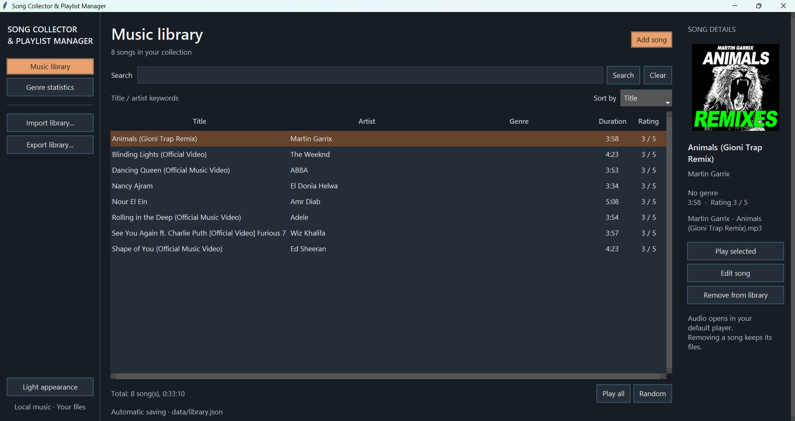
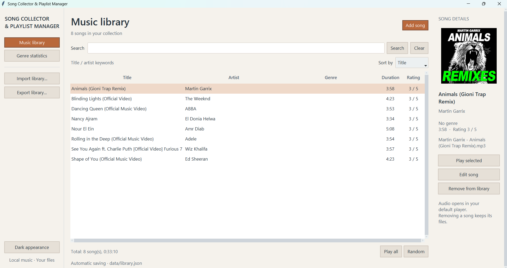
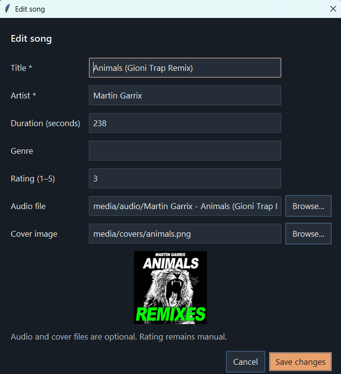

# Song Collector & Playlist Manager

A desktop music library built with **Python and Tkinter**. It helps you organize local songs, view album artwork, edit song information, and play music using your default Windows audio player.

Originally developed as a university Python project, then improved with a redesigned interface, automatic metadata detection, local file management, and automated tests.



## Features

- **Organize songs:** Add, edit, remove, search, and sort tracks by title, duration, rating, or date added.
- **Read MP3 information:** Detect the title, artist, duration, and genre when available using Mutagen. Suggest information from the filename when tags are missing.
- **Display album artwork:** Use embedded cover art, matching local images, or a manually selected cover.
- **Keep files organized:** Copy imported audio and artwork into local media folders and use relative paths where possible.
- **Save automatically:** Store the music library in a local JSON file. Import and export JSON libraries for backups.
- **Play music:** Double-click a track or use **Play selected**. **Play all** opens an M3U playlist in the Windows default player, and **Random** chooses a track.
- **Switch appearance:** Use light or dark mode, with a song-details panel and genre statistics.

## Screenshots

### Light mode



### Song details and artwork



## Built with

- **Python:** Application logic and file handling
- **Tkinter + ttkbootstrap:** Desktop interface and themes
- **Mutagen:** Audio metadata and duration
- **Pillow:** Cover art display
- **JSON + pathlib:** Local storage and portable file paths
- **unittest:** Automated checks

## Run locally (Windows)

Install **Python 3.10 or later**, clone or download this repository, and open a terminal in its folder.

```powershell
py -m venv .venv
.\.venv\Scripts\python.exe -m pip install -r requirements.txt
.\.venv\Scripts\python.exe song_collector_gui.py
```

On the first run, the app creates or opens its local working library. Use **Add song** to select an MP3. Available information and artwork will be filled in automatically, and you can correct them before saving.

**Note:** The application opens music in your default Windows audio player. It is not a built-in streaming service.

## Run tests

```powershell
.\.venv\Scripts\python.exe -m unittest discover -s tests -p "test_*.py" -v
.\.venv\Scripts\python.exe -m unittest discover -s tests -p "gui_checks.py" -v
```

The second command runs checks that require a graphical Windows desktop session.

## Project files

```text
song_collector_gui.py    Desktop interface and user interactions
media_library.py         Local library and media-path handling
metadata_extractor.py    MP3 tags, duration, and artwork extraction
requirements.txt         Python packages
tests/                   Automated tests
screenshots/             Application screenshots
```

The working `data/library.json` and imported music files are local user data, not part of the source code. Add your own audio files and artwork that you have permission to use.
